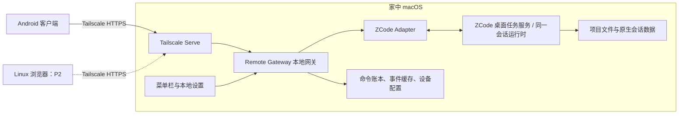

# ZCode Remote 产品需求文档与可行性评估

版本：v1.0（开发评审稿）  
日期：2026-11-05  
目标用户：个人开发者，同一用户使用家中 Mac、Android 手机和 Linux 笔记本。  
优先级调整：首先交付 Android + macOS 两端；Linux 浏览器端及三端同时操作放到第二阶段。

> 核心目标：人在外面时，用手机查看并继续家中 Mac 的智谱 ZCode 项目与已有任务，下发新任务、处理必要确认、监控执行过程并查看结果。Mac 是执行主机与任务事实来源。首版必须接入同一套任务，不能用另一套独立会话冒充同步。

## 1. 可行性结论

**有条件可行，建议先做两端接管验证，通过后开发正式客户端。**

Tailscale 能解决设备间私有网络连接；主要技术不确定性在 ZCode 的桌面任务接入方式、接口稳定性以及控制权协调。首版缩减为手机与 Mac 两端，可显著降低远程多客户端并发和界面开发成本，但仍须验证桌面与手机对同一任务的操作一致性。

| 能力 | 判断 | 交付条件 |
| --- | --- | --- |
| 手机通过 Tailscale 访问 Mac 上的服务 | 高可行 | 三端中的使用设备加入同一 tailnet；Mac 在线 |
| 查看 Mac 当前窗口中的项目、任务并继续对话 | 官方已有相关能力，集成需验证 | 目标 ZCode 版本及接入协议验证通过 |
| 安卓应用提供类似 DSH Go 的远控体验 | 可行 | 在 Mac 侧统一适配 ZCode；手机只承担控制界面 |
| Mac 桌面已有任务与手机保持一致 | 第一阶段关键门槛 | 同一项目、任务和会话身份，能双向继续并持久化 |
| Linux 通过浏览器访问 | 架构上可行，第二阶段交付 | 复用 Mac 网关，完成 Web 适配与鉴权 |
| 手机与 Linux 同时远控 Mac | 需要额外开发验证 | 多订阅者、单任务命令串行、冲突和审批处理 |
| 手机熄屏后始终即时收到通知 | 不保证 | Android 后台限制、网络及推送渠道影响 |
| Mac 休眠、关机后继续执行任务 | 不可作为本方案能力 | 需要保持主机可用；远程唤醒另行设计 |
| 任意历史任务无损接管 | 尚未确认 | 需检验持久化格式、会话恢复与工作区发现范围 |

### 1.1 已核实的产品基础

1. 智谱 ZCode 官方文档描述了 Remote Control：手机能够接入当前桌面窗口的已登记工作区、任务与会话，并继续给 Agent 发指令；执行仍发生在原工作区对应的机器上。文档明确当前只允许一个手机页面连接，关闭桌面窗口或失去网络后不可继续；它并不复制代码。[来源：ZCode Remote Control](https://zcode.z.ai/cn/docs/remote-control)
2. ZCode 官方仓库提供桌面、Web、CLI 及后端源码，并说明了 `zcode --web` 启动入口、工作区设置和认证配置。这为本地服务适配提供了基础；但该说明不能证明另起 Web 服务后会自动共享桌面已有会话。[来源：ZCode 官方仓库](https://github.com/zai-org/ZCode)
3. DSH Go 是 DeepSeek Harness 的 Android 客户端，提供远程主机、对话、工具审批及网页模式等交互。它可作为体验参考，不能据此认定其协议兼容 ZCode。用户提供的站点本次未能由检索工具直接访问，能力核对采用其项目仓库。[来源：DSH Go 仓库](https://github.com/ccch1mneyyy/dsh-Go)
4. Tailscale Serve 可将本地服务向 tailnet 内设备提供访问，支持 HTTPS 并受网络访问规则约束；Funnel 用于公网分享，不是本产品默认通道。[来源：Tailscale Serve](https://tailscale.com/docs/features/tailscale-serve)
5. Tailscale 连接可能直连，也可能经中继，不能承诺所有网络均有相同延迟。[来源：Tailscale 连接类型](https://tailscale.com/docs/reference/connection-types)
6. Android 的 Doze 与 App Standby 会推迟后台 CPU 和网络活动，因此“永久 WebSocket 在线”不能作为通知可靠性的设计前提。[来源：Android 后台节电机制](https://developer.android.com/training/monitoring-device-state/doze-standby)

### 1.2 尚未验证，不能写成现成功能

- 用户 Mac 实际安装的 ZCode 版本、构建来源、CPU 架构及其与开源代码的对应关系。
- 官方 Remote Control 的连接是否可完全由 Tailscale 私网承载，是否依赖厂商中转，以及有无受支持的接入接口。
- 独立 Web/CLI 与桌面版是否共享任务存储、是否可安全恢复同一会话、是否允许多进程访问。
- 项目枚举、任务创建、事件订阅、停止、审批和续聊的接口覆盖范围与兼容承诺。
- 不在当前桌面窗口中的历史项目及任务是否可通过受支持方式读取、登记和恢复。
- 手机与桌面同时输入时，原生端是否已有串行机制；桥接层能否覆盖桌面本地操作。

本评估基于官方文档与公开仓库说明，**未在用户的 Mac 或 Android 真机上完成联调**。下文功能、接口及指标为本产品拟定要求，不是对 ZCode 现有接口的保证。

## 2. 产品定位与边界

### 2.1 一句话定位

面向个人开发者的 ZCode 私网远程控制台：Mac 持续执行，手机随时接手，后续支持 Linux 浏览器协作查看和控制。

### 2.2 “同步”的明确定义

| 同步对象 | 首版含义 | 不包含的内容 |
| --- | --- | --- |
| 项目 | 展示 Mac 已授权、已登记的项目及路径摘要 | 自动复制整个仓库到手机 |
| 任务 | 同一原生任务 ID、状态、标题与更新时间 | 两边各自生成内容相似的独立任务 |
| 会话 | 双向可见的用户消息、Agent 回复与必要执行事件 | 仅镜像截图或定时复制聊天文本 |
| 执行 | 手机下发的操作在 Mac 原任务上下文中执行 | 在手机另起模型运行环境 |
| 结果 | 最终回复、变更摘要、测试记录及授权产物 | 默认把全部源代码长期缓存到手机 |

代码文件在 Mac 上保持唯一工作副本。Linux 第二阶段也默认采用远程查看与操作；如果以后需要离线开发，通过独立 Git 工作流设计，不与任务同步混为一项功能。

### 2.3 分期范围

| 阶段 | 范围 | 成功定义 |
| --- | --- | --- |
| P0 技术验证 | Mac + 手机浏览器/临时客户端 | 用手机续接一条 Mac 已有任务，Mac 可见并能继续；路径符合 Tailscale 要求 |
| P1 两端 MVP | Android 安装包 + macOS 伴随服务 | 稳定下发、监控、审批、结果查看和断线恢复 |
| P2 三端扩展 | Linux B/S、多个远程查看端 | 手机、笔记本、Mac 对同一任务保持一致，冲突可控 |
| P3 可选增强 | 推送、附件、多主机、导出、独立工作树并发 | 按真实使用需求逐项追加 |

P1 不包含：多用户团队权限体系、手机本地运行模型、通用远程桌面、无人值守远程开机、任意主机 Shell 入口、代码目录双向文件同步、自动发布或自动合并代码。

## 3. 用户场景与体验要求

### 3.1 出门后接续任务

Mac 上已有“修复登录异常”任务正在运行。用户在手机打开该任务，看到最近消息、执行工具、最后活动时间；补充“优先兼容 Android WebView”。该输入进入原任务，Mac 桌面能看到相同消息和随后产生的结果。

### 3.2 从手机新建任务

用户选择已授权项目，填写任务目标和验收要求，点击发送。界面先显示“发送中”，在 Mac 持久化确认后显示“已接收”，开始执行后才显示“运行中”。请求超时显示“提交结果待确认”，查询原请求状态，不诱导用户重复创建。

### 3.3 处理阻塞

任务要求执行需要批准的命令或补充信息。手机显示具体操作、项目、影响范围及批准/拒绝选项；Mac 与手机任一端完成处理后，另一端立即失效，避免重复批准。

### 3.4 查看与验收结果

用户看到最终回复、变更文件清单、可用的 diff、测试命令与退出状态、失败原因及产物。用户可以继续提出修改要求。Agent 自报完成与测试通过分别呈现，不将“进程正常结束”直接等同于需求验收通过。

### 3.5 网络切换与主机离线

手机从 Wi-Fi 切换到蜂窝网络，页面保留最后确认的数据并标记时间。恢复后先补事件、校准状态，再允许依赖最新状态的操作。Mac 不可达时允许保存草稿，不将草稿自动排队执行。

## 4. 推荐架构与路线选择

### 4.1 两端优先的部署结构

Linux 的 B/S 中，浏览器在笔记本，服务端在 Mac；无需在笔记本部署另一个任务服务。Android 使用独立 Tailscale 客户端建立网络，本产品不自建 VPN。

网关负责认证、命令去重、事件补发、设备管理和统一接口。Adapter 负责映射 ZCode 能力。ZCode 原生任务存储仍是任务事实来源；网关不能建立另一套相互竞争的执行状态。

### 4.2 路线决策表

| 路线 | 用途 | 限制及决策 |
| --- | --- | --- |
| A. 直接试用官方 Remote Control | 最快验证两端体验与用户需求 | 先验证传输路径；若依赖厂商远控链路，不满足纯 Tailscale 控制要求 |
| B. 伴随网关接入桌面任务服务 | 首选正式方案 | 必须证实可复用同一任务，不能仅依据 Web 启动入口推断 |
| C. 基于固定版本源码增加本地桥接 | B 无可用入口时的备选 | 需维护自有构建、升级适配，并验证官方安装版能力差异 |
| D. 在 Mac 新起独立 ZCode Web/CLI | 可用于网络和执行原型 | 若不共享桌面已有任务，只能标为“独立执行模式”，不得作为两端同步交付 |
| E. 远程桌面/屏幕自动化 | 人工诊断辅助 | 不作为正式任务同步协议，不能保证结构化状态和可靠审批 |

选择顺序：先用 A 了解既有能力，再验证 B；B 不满足时评估 C。D 只有在用户明确接受需求变更后才能转为正式范围。三端失败不阻止交付已验证的两端方案。

### 4.3 双端操作权

首版允许 Mac 与手机同时查看；同一任务的写操作必须串行。不能假定网关锁能够拦截 Mac 原生桌面按钮。

- 如果原生服务支持统一串行与版本控制，直接接入并验证。
- 如果不能统一协调，增加“桌面控制 / 手机控制”显式切换，且必须在共同执行入口实现写限制。
- 若只能在手机侧显示提示而无法约束桌面执行，则不承诺并发写入安全；P1 须采用能实际执行的互斥方案，或暂不放行。
- 网络断开不自动强停任务，也不自动解除仍在执行的操作；控制权重新授予前先核对当前运行状态。

## 5. 功能需求

### 5.1 macOS 伴随服务

| ID | 优先级 | 需求与验收要点 |
| --- | --- | --- |
| MAC-01 | P1 | 本地启停、服务状态、ZCode 连接状态、版本兼容性及诊断入口 |
| MAC-02 | P1 | 首次在 Mac 授权可远控的项目；手机不能任意遍历磁盘 |
| MAC-03 | P1 | 显示一次性配对码/二维码、已配对设备及撤销入口 |
| MAC-04 | P1 | 检测 ZCode 退出、权限缺失、工作区不可用和认证失效，提供可操作原因 |
| MAC-05 | P1 | 用户登录后启动服务；任务期间可选防止系统自动睡眠，并在本地明确展示 |
| MAC-06 | P1 | 服务重启后恢复命令账本及订阅，先查询实际任务，不盲目重放任务 |
| MAC-07 | P1 | 配置、事件与诊断日志可备份、轮转和导出，导出前脱敏 |
| MAC-08 | P2 | 多远程设备连接、查看状态及控制设备审计 |

部署默认采用用户级服务，使用用户已有 ZCode 环境；不以 root 执行任务。登录自启动不意味着 FileVault 解锁前或用户未登录时也可操作桌面应用。关闭笔记本盖子的行为、断电恢复及系统更新后的状态必须在实际 Mac 上测试，不作为自动保证。

### 5.2 Android 客户端

| ID | 优先级 | 需求与验收要点 |
| --- | --- | --- |
| AND-01 | P1 | 手动输入主机地址或扫码配对，显示连接、认证及服务就绪状态 |
| AND-02 | P1 | 项目列表、任务列表、最近更新排序和任务状态筛选 |
| AND-03 | P1 | 打开已有任务、分页历史消息、流式回复与工具事件卡片 |
| AND-04 | P1 | 新建任务、追加消息、保存本地草稿和提交状态查询 |
| AND-05 | P1 | 停止请求、必要审批和用户提问响应；仅展示实际支持的操作 |
| AND-06 | P1 | 结果摘要、变更文件、文本 diff、测试结果；大内容按需加载 |
| AND-07 | P1 | 断线提示、重连补发、后台回前台全量校准 |
| AND-08 | P1 | 前台任务完成/失败/待确认提示；未读事件列表 |
| AND-09 | P2 | 可选后台通知，明示渠道、授权及延迟边界 |
| AND-10 | P3 | 图片附件、系统分享输入、结果导出 |

体验借鉴 DSH Go 的主机入口、连续对话和折叠工具过程。首版聚焦远控，不需要在手机内置 Linux、Node 或 ZCode 执行环境。默认中文界面，时间按手机本地时区展示。

### 5.3 Linux Web 客户端（第二阶段）

- 使用与 Android 相同的主机服务和任务 ID，通过 HTTPS 在浏览器访问。
- 页面采用项目列表、任务列表、会话/结果区布局，适配笔记本屏幕。
- 支持创建、追加、审批、停止及结果查看，按后端能力展示功能。
- 页面关闭不影响 Mac 执行；重新打开后校准状态。
- 与手机同时查看时使用独立订阅游标；写操作与审批采用同一冲突机制。
- 浏览器仅保存必要缓存与会话凭据，不在本地长期存放模型密钥。

### 5.4 项目、任务与历史发现

首版承诺当前登记并获授权的项目及这些项目中可安全接入的任务。每个项目记录来源、工作区 ID、可接入范围和最后同步时间。

历史任务若只能查看，必须标为“历史记录，只读”；若能续接，必须验证恢复后仍属同一原生会话。不得自动扫描全部用户目录来填充项目列表。首版需在客户端明确展示无法接入的任务与原因，而非静默遗漏。

## 6. 状态与命令语义

### 6.1 分离连接状态与运行状态

连接状态：`connecting / online / reconnecting / offline / unauthorized / incompatible`。

运行状态建议：`queued / running / waiting_input / waiting_approval / cancel_requested / succeeded / failed / cancelled / unknown`。

- `offline` 表示客户端无法观察主机，不能把正在运行的任务改成失败。
- `cancel_requested` 表示请求已送达，只有引擎确认停止后才能显示 `cancelled`。
- 原生引擎没有某状态时，Adapter 必须记录映射依据；未知状态保持 `unknown`。
- “任务完成”与“本轮 Run 完成”区分：一个任务可多次追加消息产生多个 Run。
- 停止不等于回滚，已有文件变更应继续显示；恢复/重试须创建可追踪的新 Run。

### 6.2 消息与审批

运行中追加消息的语义必须由能力决定：支持插话则提交给当前 Run；只支持排队则显示“等待本轮结束”；不支持时仅允许保存草稿。客户端不能伪造“已生效”。

审批绑定原生请求 ID、任务、操作摘要、版本与有效期。批准只作用于该项操作；过期、已处理或版本不一致时返回明确冲突并刷新，不可把旧审批用于后续命令。

## 7. 一致性、断线恢复与文件边界

### 7.1 权威来源和持久化

ZCode 决定任务执行状态；网关保存命令账本、原生 ID 映射、已观察事件和缓存快照。SQLite 等轻量持久化方案可满足个人使用，最终选型以 P0 实验为准。

任务、消息、Run、审批均使用稳定 ID。所有客户端快照包含 `revision` 与同步时间，服务端时间以 UTC 保存。

### 7.2 命令去重与执行不确定性

- 客户端为每次操作生成 `clientCommandId`；同一设备的重试沿用该 ID。
- 网关先持久化命令，再调用 Adapter；相同 ID 的重试返回原操作状态。
- 相同 ID 但内容不同应拒绝；状态查询接口覆盖客户端提交超时场景。
- 若引擎不支持幂等，网关在“调用成功但尚未记账”时崩溃仍可能无法判断是否执行。此时进入“结果待核对”，查询原生任务和消息，禁止自动重发。
- 不宣称跨进程、跨崩溃边界的绝对 exactly-once；验收重点是常规重试不重复，异常不确定状态可识别且不自动重复产生副作用。

### 7.3 事件恢复

网关提供带递增序号的事件流和游标。客户端按事件 ID 去重，检测断档后补拉；游标超出保留窗口时获取最新快照及必要历史。事件序号只保证网关已接收事件的顺序，不能凭空恢复引擎从未持久化的输出。

建议首版事件保留 7 天、诊断日志保留 14 天，均可配置并设置容量上限；任务正文保存遵循 ZCode 原生机制。无法恢复的过程片段显示“部分记录缺失”，不能制造连续完整的假象。

### 7.4 并发与文件

首版默认每个项目最多一个写文件任务并行运行，其他写任务排队。项目内桌面手动改文件仍可能冲突，执行前记录 Git 基准，结果区展示当前差异，避免自动覆盖。

扩展并行时，优先为独立任务分配 Git worktree；合并必须另行确认。普通目录不具备 Git 隔离条件时继续串行。网关不直接编辑 ZCode 私有数据库，不对运行中的数据库做文件级同步。

## 8. 页面与信息架构

### 8.1 Android

1. 主机页：家庭 Mac、连接状态、最近连接、配对/撤销说明。
2. 项目页：授权项目、运行任务数、最近活动、不可接入原因。
3. 任务页：运行中、待确认、已完成等筛选，新建入口。
4. 会话页：消息、折叠工具卡、输入框、控制权与停止按钮。
5. 结果页签：最终摘要、变更、测试与产物。
6. 设置：缓存清理、通知方式、兼容信息、诊断导出。

持续显示主机名和项目名，减少对错误项目下发指令。等待与错误状态使用明确文本，不只用颜色。流式输出可暂停自动滚动，复制内容时不强制滚回底部。

### 8.2 macOS

菜单栏提供服务状态、打开设置、暂停远控及退出。设置窗口包含项目授权、配对设备、运行环境、启动/睡眠策略及诊断。退出远控与停止 Agent 任务为两个独立动作，界面必须说明结果。

## 9. 网络、认证与权限

- 默认只在 Mac loopback 监听，通过 Tailscale Serve 提供 HTTPS；不开放公网入站，不启用 Funnel。
- tailnet 规则限制访问主体和服务端口；同一 tailnet 不自动等于拥有项目控制权限。
- 首次配对由 Mac 本地生成短期一次性随机码；默认 5 分钟失效，尝试限速。设备凭据可单独撤销。
- Android 凭据使用系统安全存储；Web 使用安全会话 Cookie、CSRF 防护和 Origin 校验；流连接也必须鉴权。
- 若使用 Serve 的身份头，仅信任受控代理路径；保留应用层设备配对，不能把任意客户端自报身份视为可信。
- Mac 撤销设备后拒绝新请求并断开现有订阅；断网设备再次连接时必须重新鉴权。
- 模型密钥留在 Mac，日志和结果中对密钥、授权头及敏感配置脱敏；手机无需保存模型 API Key。
- 文件接口限于授权目录，规范化路径并检查符号链接逃逸；产物下载使用鉴权资源 ID，不能接受任意绝对路径。
- 默认沿用 ZCode 安全操作确认，不为远程使用开启全局自动批准。
- 记录任务创建、追加、停止、批准/拒绝和设备撤销的时间、设备与结果；诊断导出不包含完整凭据。

“通过 Tailscale”约束的是自建远控链路，不代表模型推理、ZCode 登录及其已有外部服务自动改为本地。P0 应记录实际连接目的地；若官方远控需要外部转发，应明确标记并改走本地桥接，或由用户选择接受该差异。

## 10. 通知与主机可用性

### 10.1 通知分级

P1 保证前台在线提示与重连后未读事件补齐，不承诺息屏必达。通知内容至少包含主机、项目、任务和事件类型；锁屏默认隐藏正文。

P2 可选系统推送或用户自选通知渠道，推送只含事件标识，正文通过认证后从 Mac 拉取。无可用推送服务的设备仍靠前台刷新和补齐；用户主动开启前台服务也需真机评估耗电与系统限制，不作为所有机型的可靠保证。

### 10.2 可用性诊断

区分：Tailscale 未连接、主机不可达、网关不可达、设备未认证、ZCode 未运行、工作区失效、模型调用失败。无法诊断时报告已知事实，不凭网络超时断定 Mac 已关机。

主机保持供电和联网；任务期间可配置防自动睡眠。首版不承诺从关机、深度睡眠或登录锁定状态远程恢复。模型限额、认证过期等显示为执行依赖异常，不能误报通道故障。

## 11. 建议的数据模型与内部 API

以下为**自建网关建议契约，不是 ZCode 官方 API**。P0 后依据可接入能力细化。

| 对象 | 最少字段 |
| --- | --- |
| Host | id、名称、服务版本、ZCode 构建信息、能力集、就绪状态 |
| Device | id、名称、凭据标识、授权范围、撤销状态 |
| Project | id、nativeWorkspaceId、名称、授权根目录、可接入范围 |
| Task | id、nativeTaskId、projectId、标题、revision、最近活动 |
| Run | id、nativeRunId、taskId、状态、开始/结束时间、终止原因 |
| Message | id、nativeMessageId、taskId、角色、内容、提交状态 |
| Command | clientCommandId、deviceId、payloadHash、状态、原生回执 |
| Approval | id、nativeRequestId、runId、操作摘要、版本、截止时间 |
| Event | eventId、streamSeq、taskId、runId、类型、时间、payload |
| Artifact | id、runId、类型、大小、校验值、访问策略 |

| 方法与路径 | 用途 |
| --- | --- |
| `GET /v1/health` | 最小健康状态，不泄露项目及配置 |
| `GET /v1/capabilities` | 当前支持功能及兼容状态 |
| `POST /v1/pair` | 用短期配对码换设备授权 |
| `GET /v1/projects` | 已授权项目 |
| `GET /v1/projects/{id}/tasks` | 分页任务列表 |
| `POST /v1/projects/{id}/tasks` | 创建任务，携带幂等 ID |
| `GET /v1/tasks/{id}` | 快照、revision 和能力 |
| `GET /v1/tasks/{id}/messages` | 分页历史 |
| `POST /v1/tasks/{id}/messages` | 追加消息，携带预期版本 |
| `POST /v1/runs/{id}/cancel` | 请求停止，返回受理状态 |
| `POST /v1/approvals/{id}/resolve` | 单项批准或拒绝 |
| `GET /v1/commands/{id}` | 查询提交结果 |
| `GET /v1/events?after={cursor}` | SSE 事件补发与订阅，或等价 WebSocket 协议 |
| `GET /v1/artifacts/{id}` | 授权产物读取 |

统一错误区分未认证、无权限、资源不存在、版本冲突、功能不支持、引擎离线及执行结果未知。能力缺失返回明确原因；客户端隐藏或禁用相应按钮。响应不把内部栈、密钥或原始数据库路径直接交给客户端。

## 12. 非功能指标与验收

以下为拟定目标，需 P0 测试校准。参考负载：一个 Mac、20 个已登记项目、1,000 条任务记录、每页 50 条、P1 一个远程查看端。性能统计排除模型生成时间，受控测试网络 RTT ≤100ms、丢包率 <1%。中继和弱网另行记录，不承诺相同指标。

| 指标 | P1 目标 |
| --- | --- |
| 已接收命令确认 | P95 ≤2 秒，含网关持久化，不代表 Agent 已开始执行 |
| 前台事件可见延迟 | 网关收到事件后至客户端展示 P95 ≤2 秒 |
| 首屏任务列表 | 鉴权完成后 P95 ≤3 秒 |
| 短断线恢复 | 网络恢复后 10 秒内开始补齐，最终状态与 Mac 一致 |
| 常规重试去重 | 同一命令连续重试 10 次，原生侧只产生一次对应操作 |
| 崩溃不确定性 | 能识别待核对操作，不自动重新产生副作用 |
| 过程稳定性 | 连续 8 小时任务观察与 24 小时服务运行无不可恢复错乱 |
| 安全 | 未配对设备不能读取项目、消息或产物；撤销后现有连接失效 |

### 12.1 两端发布必测场景

| 编号 | 场景 | 通过标准 |
| --- | --- | --- |
| AT-01 | Mac 新建并开始任务，手机打开 | 同一原生任务/会话；消息和状态一致 |
| AT-02 | 手机追加需求 | Mac 原任务可见且执行；手机没有另起独立会话 |
| AT-03 | 手机新建任务 | Mac 能在约定项目中找到并继续该任务 |
| AT-04 | Mac 本地追加消息 | 手机收到；与手机同时写入时串行或明确冲突 |
| AT-05 | 同一审批在两端处理 | 只有一次决定生效，另一端及时失效 |
| AT-06 | 手机断网 5 分钟后恢复 | Mac 持续执行；补齐可恢复事件并标记缺失 |
| AT-07 | 下发成功但响应丢失 | 查询/重试不会重复创建任务 |
| AT-08 | 网关在下发前后分别崩溃 | 无自动重复执行；未知状态有核对路径 |
| AT-09 | 停止长任务 | 显示受理和真实终态，已有文件变更不被隐瞒 |
| AT-10 | Mac 休眠、ZCode 退出、模型错误 | 分类展示；不把断线改写为任务失败 |
| AT-11 | Android 息屏并被系统回收 | 再打开后状态正确，未读事件可见 |
| AT-12 | 未授权目录、路径穿越、撤销设备 | 拒绝访问，审计可查 |
| AT-13 | 完成含代码修改与测试的任务 | 摘要、diff、测试记录对应同一 Run，无结果串线 |
| AT-14 | 重启与版本不兼容 | 可恢复已登记任务；不兼容时停止写操作并提示 |
| AT-15 | 检查远控链路 | 自建控制流经 Tailscale；外部依赖有清单且无隐性远控绕行 |

P2 增加：手机与 Linux 同时订阅、同时提交、同时审批、多个标签页、跨端草稿隔离与逐设备撤销。P2 未通过不影响已满足上述条件的两端版本。

## 13. 技术验证计划与停止条件

### 13.1 P0 实验清单

1. 记录目标 Mac、Android、Tailscale 与 ZCode 版本及构建标识，准备一个不含敏感信息的测试项目。
2. 用官方 Remote Control 验证当前窗口、任务续聊、手机新建、审批及桌面关闭后的行为，记录实际范围。
3. 验证网络路径，确认能否通过 Tailscale 暴露本地控制入口；不能以“手机装了 Tailscale”作为链路验收证据。
4. 检查本地服务/扩展入口，建立项目、任务、会话及 Run 的 ID 对照。
5. 完成 Mac 建任务 → 手机续聊 → Mac 继续 → 手机查看结果的闭环。
6. 完成客户端断线、网关重启、重复提交和一次审批冲突测试。
7. 若需修改源码，验证自有构建的账号、模型、插件、工具和会话恢复能力，确认维护成本。
8. 输出能力矩阵、采用路线、失败项、复现记录与 P1 工期修订。

CLI 官方指南提示应记录构建信息，并注明开源导出中的 Computer Use 使用占位实现。因此源码路线不能被视为与官方桌面安装包所有能力等价。[来源：ZCode CLI 使用指南](https://github.com/zai-org/ZCode/blob/main/apps/zcode-cli/docs/usage/README.md)

### 13.2 Go / No-Go

**可进入两端 MVP：** 能通过确定的接入路径读写同一原生任务，事件/历史可恢复，审批与停止语义明确，且远控链路符合要求。允许首版只覆盖已登记项目，但必须公开范围。

**暂停完整客户端开发：** 只能读取日志、只能新建隔离会话、只能屏幕点击，或无法确定审批与命令是否重复执行。此时继续定向验证桥接，不用大量 UI 开发掩盖核心能力缺口。

**三端延期：** 双端闭环成立，但多个远程连接不稳定。按用户最新要求先发布两端，Linux 留在 P2。

**需重新选择路线：** 唯一可用方式依赖非 Tailscale 远控链路，或必须维护成本明显超出预期的源码分支。提供具体实验结果后再由用户决定接受差异还是继续桥接。

## 14. 技术选型建议与开发安排

### 14.1 建议选型

- 网关/Adapter：优先 TypeScript + Node.js，便于评估 ZCode 相关源码和协议；不要在接口尚不明确时先绑定重型服务框架。
- macOS：用户级服务加轻量菜单栏壳，负责启动、配对、授权和诊断。
- Android：优先 Kotlin + Compose，方便处理系统凭据、生命周期和通知；若团队已有 Flutter 经验也可选 Flutter。DSH Go 仅作为交互参考。
- Linux Web：P2 使用成熟 Web 框架，实现同一 API 的客户端；无需复制 Android 整套运行环境。
- 事件：优先 HTTP 命令 + SSE 订阅，若原生协议或双向事件需求更适合 WebSocket，则统一适配；两种均需鉴权和断线恢复。
- 存储：网关 SQLite + 有界事件缓存；ZCode 数据依原生机制保存，避免两个进程竞争写同一私有库。

上述为工程建议，不是强制技术栈。实现时锁定经过验证的依赖版本与 ZCode 构建，维护兼容矩阵；对不兼容升级优先停止写操作。

### 14.2 工作量估算

假设一名熟悉全栈与 Android 的开发者、个人使用、不做应用商店审核，并且 P0 找到可维护的同会话入口。以下为规划估算，不是承诺。

| 里程碑 | 工作量 | 交付物 |
| --- | --- | --- |
| M0：可行性 PoC | 3–7 个工作日 | 同任务接管证据、能力矩阵、路线结论 |
| M1：Mac 网关与基础控制 | 5–10 个工作日 | 配对、项目任务接口、命令账本、事件恢复 |
| M2：Android 两端闭环 | 7–12 个工作日 | 可安装 APK、会话、审批、结果、重连 |
| M3：两端稳定与分发 | 5–8 个工作日 | 真机验收、启动配置、诊断与安装说明 |
| M4：Linux B/S 与三端 | 5–10 个工作日 | Web 客户端、多端并发验收 |

M0–M3 合计约 20–37 个工作日。若必须深改 ZCode 桌面桥接或协议，M0 后重新估算，不能把表内范围直接套用于源码分支维护。

成本项包括 Mac 电力与网络、现有模型调用/订阅、可选签名分发和推送服务。Tailscale 套餐适用性以实际账户政策为准，此文不假设永久免费；首版默认无需新增业务云服务器。

## 15. 风险、待确认项与交付定义

| 风险 | 对策 |
| --- | --- |
| ZCode 内部接口随版本变化 | Adapter 隔离、锁定版本、兼容自检、保留回退包 |
| 独立 Web 与桌面数据不共享 | 同任务 ID 和双向续聊作为硬性验收 |
| 官方远控限制单页面 | 首版仅一个远程手机客户端；三端需独立验证 |
| 网关锁绕不过桌面本地操作 | 在共同执行入口协调，或实施真正的控制权互斥 |
| 主机不在线 | 明确前置条件、状态诊断、任务期间防自动睡眠选项 |
| 移动网络和 Android 后台中断 | 事件游标、状态快照、未读记录；通知按等级承诺 |
| 日志量与产物过大 | 分页、限量、按需读取、轮转与磁盘告警 |
| 源码复用与分发要求不清 | 复用前核对各组件许可、NOTICE 与资源授权；不默认复制 DSH Go 品牌或图像 |

后续实施前需记录：Mac 型号和系统版本、ZCode 实际构建、Android 机型、是否接受自有 ZCode 构建、历史任务覆盖要求及通知偏好。这些信息不妨碍本 PRD 成稿，但会影响 P0 及工期。

**P1 完成交付：** Android APK、macOS 服务/伴随应用、版本兼容清单、安装与配对说明、项目授权说明、升级/回滚流程和 AT-01～AT-15 测试记录。首版交付必须能够接续 Mac 已有任务；仅有原型、独立执行入口或官方远控链接不等同于完成自建产品。

**产品验收语句：** 用户离开家后，仅用手机即可找到家中 Mac 已登记的 ZCode 项目，继续同一任务、处理阻塞并检查结果；回到 Mac 后仍在原任务中继续。Linux 的加入不得破坏这个已经可靠成立的两端闭环。
